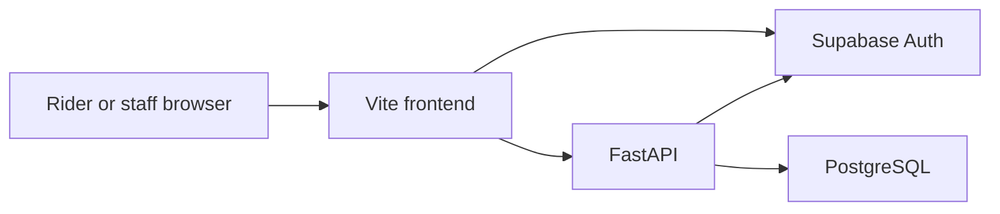

# Trippy Corporate Mobility

Trippy helps Dhaka office commuters reserve a numbered seat on a scheduled route. A subscription includes a morning pickup and an evening return on the route’s configured operating days. Transport teams manage stops, schedules, vehicles, drivers, and fares through the Operations workspace.

[Public site](https://trippy-corporate-mobility.pages.dev/) · [Architecture](docs/ARCHITECTURE.md) · [API reference](docs/API.md) · [Quick start](#quick-start)

**Release status:** The hosted application supports product review and QA. Paid service launch requires approved bookable routes, operational verification, and live payment validation. [Release checklist](docs/PRODUCTION_READINESS.md)

## What the platform supports

| Area | Capability |
| --- | --- |
| Route discovery | Search Dhaka pickup and drop-off locations, filter by vehicle, and compare available subscription plans. |
| Seat subscriptions | Choose a numbered seat in a bus, Hiace, or shared car for a 1-, 3-, 6-, or 12-month term. |
| Fare management | Authorized staff set base fares and discounts in **Operations → Pricing**. The API calculates quotes from saved settings, and existing reservations retain their quoted prices. |
| Fleet operations | Maintain route timetables, seat maps, vehicle verification, and driver assignments. Review requests for new routes or additional capacity. |
| Rider and driver tools | View subscription passes, access trip tracking where driver location is available, or report a service concern. |
| Checkout | Demo checkout simulates payment. The live checkout integration uses SSLCOMMERZ and requires merchant configuration and end-to-end validation before launch. |

## Architecture



The frontend handles route discovery and the booking experience. FastAPI checks identity and permissions, calculates fares, and coordinates booking transactions. PostgreSQL enforces seat availability across overlapping dates and route segments.

| Environment | Hosting and access |
| --- | --- |
| Dev | Cloud Run serves the frontend and API together. Google IAP limits access to approved testers, and the application uses a separate Dev Supabase project. |
| PRD | Cloudflare Pages serves the public frontend. The browser calls the PRD API on Cloud Run, which uses separate Supabase Auth and PostgreSQL services. Staff operations require an approved role and authenticator verification. |

See the [Dev deployment runbook](docs/THEAM_DEV_CLOUDRUN_DEPLOY.md), [hosted rollout guide](docs/HOSTED_ROLLOUT.md), and [staff access setup](docs/ADMIN_SETUP.md).

## Booking workflow

1. The rider selects a route, stops, subscription term, and available seat.
2. The API calculates the fare and creates a time-limited seat hold. PostgreSQL prevents conflicting holds.
3. For paid bookings, the API verifies the gateway response before confirming the reservation. Confirmed riders receive a subscription pass.

See the [API contracts](docs/API_CONTRACTS.md) and [demo booking guide](docs/DEMO_BOOKINGS.md).

## Quick start

**Requirements:** Docker Engine with Compose and a dedicated development Supabase project. Configure the identity providers you intend to test. Sandbox merchant credentials are needed only for sandbox payment checks.

```bash
cp .env.example .env
# Set DB_PASSWORD, SUPABASE_URL, and SUPABASE_PUBLISHABLE_KEY in .env.
docker compose up --build
```

| Local endpoint | Purpose |
| --- | --- |
| [http://localhost:5173](http://localhost:5173) | Rider and staff web application |
| [http://localhost:8000/health/ready](http://localhost:8000/health/ready) | API and database readiness |
| [http://localhost:8000/api/docs](http://localhost:8000/api/docs) | Interactive development API reference |

Compose runs the versioned database migrator before starting the API. For a browser-only walkthrough, open [`preview/index.html`](preview/index.html) locally. It uses illustrative data.

## Development and testing

| Path | Contents |
| --- | --- |
| [`frontend/`](frontend/) | Vite frontend and browser-facing features |
| [`backend/`](backend/) | FastAPI domain modules, migration and bootstrap scripts, and backend tests |
| [`database/migrations/`](database/migrations/) | Versioned PostgreSQL schema changes |
| [`docs/`](docs/) | Product, API, access, and operating guides |

Run the backend checks with Python 3.12 and the frontend checks with Node.js 22 or later.

```bash
(cd backend && python -m pip install -r requirements-dev.txt && python -m pytest -q)
(cd frontend && npm ci && npm run check && npm test && npm run build)
```

Database integration tests require a disposable test database. See [Contributing](CONTRIBUTING.md), the [operations runbook](docs/OPERATIONS.md), and the [security policy](SECURITY.md).

## Ownership and license

Repository maintained by [Md Najmul Hossain](https://github.com/hossain0707).

Copyright © 2026 TRIPPY LTD. All rights reserved. See the [proprietary license](LICENSE) and [third-party notices](NOTICE.md).
