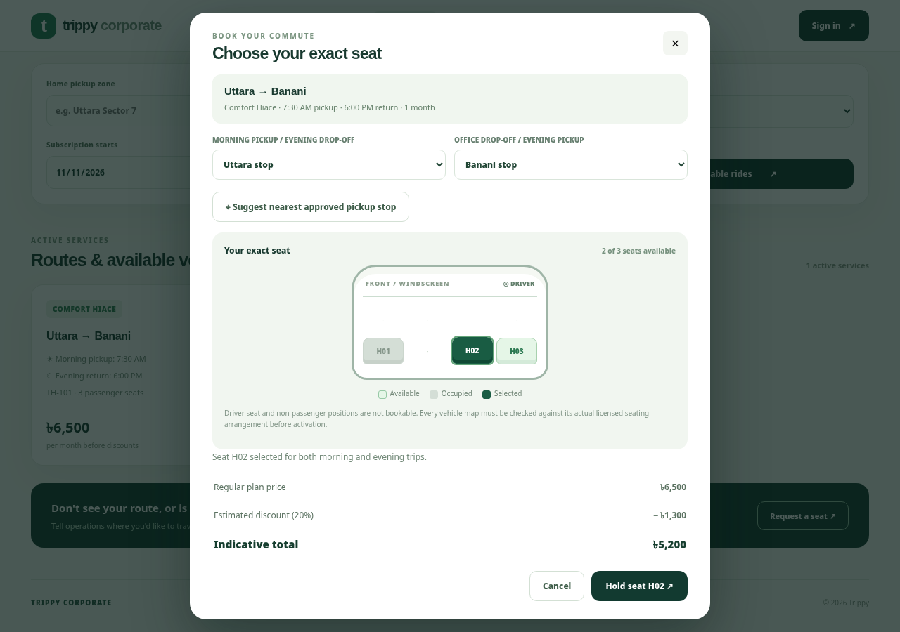

# Trippy Corporate Mobility

**Reserved seats. Reliable routes. Better commutes.**

[](https://github.com/hossain0707/Trippy-Corporate-Mobility/actions/workflows/ci.yml) · **Python FastAPI** · **PostgreSQL 16** · **Vite** · **Proprietary**

> **© 2026 TRIPPY LTD — All Rights Reserved.** This repository is *not open source*. See [LICENSE](LICENSE) and [NOTICE](NOTICE.md). Review GitHub repository visibility before posting proprietary commercial code.


> **Release classification: production-structured application source; not a verified, live, legally authorized production service.** This monorepo is independent of prior Trippy repositories and is not deployed to live infrastructure. It replaces the prior Node/Fastify backend with **Python/FastAPI**. Fictitious demonstration data is explicitly segregated from live operational data.

Trippy Corporate offers fixed-route recurring seat subscriptions for Dhaka office workers. Riders choose a specific numbered passenger seat inside a bus, Hiace, or shared private car, a verified morning pickup stop, and an office drop-off stop. Their subscription includes the reverse evening trip on configured operating days. When seats are full, riders can request additional verified fleet capacity, not overbook the existing vehicle.



## Documentation index

| Document | Audience |
|---|---|
| [Product requirements](docs/PRODUCT.md) | Product, design, operations |
| [Architecture and diagram](docs/ARCHITECTURE.md) | Engineering leads |
| [API contracts](docs/API_CONTRACTS.md) and [route matrix](docs/API.md) | Backend and frontend |
| [Team handoff](docs/TEAM_HANDOFF.md) and [contributing](CONTRIBUTING.md) | All contributors |
| [Hosted rollout](docs/HOSTED_ROLLOUT.md), [deployment](docs/DEPLOYMENT.md) and [infrastructure](infra/README.md) | DevOps/SRE |
| [Operations runbook](docs/OPERATIONS.md) | Dispatch and support |
| [Risk register](docs/RISK_REGISTER.md) and [release gates](docs/PRODUCTION_READINESS.md) | Security, QA, leadership |
| [Security policy](SECURITY.md) and [proprietary license](LICENSE) | Team members and legal |

## Source architecture (strict team ownership)

```text
trippy-corporate-fastapi/
├── backend/                           PYTHON ONLY — FastAPI API & server-side code
│   ├── app/
│   │   ├── main.py                    ASGI composition / middleware, no domain logic
│   │   ├── core/                      settings, PostgreSQL connection, auth primitives,
│   │   │                              request schema, Dhaka clock, rate limiting
│   │   └── modules/
│   │       ├── auth/                  Supabase OTP verification + rider profile
│   │       ├── catalog/               verified routes, schedules, cabin availability
│   │       ├── booking/               transactional holds, passes, coupon pricing, waitlist
│   │       ├── payments/              hosted SSLCOMMERZ, validated idempotent IPN
│   │       ├── tracking/              driver GPS, authorized rider tracking
│   │       ├── support/               passenger issue reports and operations support queue
│   │       └── admin/                 vehicle/seat map, routes, drivers, safety approvals
│   ├── scripts/                        transactional migration, owner bootstrap, local seed
│   └── tests/                          pricing, payment validation, schema & optional PG concurrency
├── frontend/                          FRONTEND ONLY — ES modules + Vite
│   ├── src/core/                      API client, session state, shared DOM helpers
│   ├── src/features/
│   │   ├── auth/                       email, configured OAuth providers, phone verification and profile
│   │   ├── search/                     route search
│   │   ├── booking/                    real physical cabin seat map and checkout
│   │   ├── passes/                     my subscriptions
│   │   ├── tracking/                   current vehicle GPS map
│   │   ├── driver/                     assigned driver GPS console
│   │   ├── demand/                     request more seats / a new corridor
│   │   ├── support/                    safety/service concerns
│   │   └── admin/                      staff fleet operations and seat-map drafting
│   └── test/                           passenger-seat template tests
├── database/migrations/               VERSIONED PostgreSQL schema changes only
├── docs/                              product, architecture, API, runbook, QA & release gates
├── .github/workflows/                 separate backend/frontend CI jobs
├── preview/                           OFFLINE self-contained browser demonstration, NO live data
├── infra/                             deployment and operations files
└── compose.yaml                       LOCAL DEVELOPMENT environment only
```

Frontend cannot directly access the database. Backend does not include UI components. Each module owns its feature and public API boundary. PostgreSQL is the single authority for seat inventory; neither DOM state nor localStorage is trusted for bookings.

## Price policy

| Vehicle | Standard / month | First paid 1-month subscription | 3 months total (25% off) | 6 months total (30% off) | 12 months total (35% off) |
|---|---:|---:|---:|---:|---:|
| Bus | ৳5,000 | ৳4,000 | ৳11,250 | ৳21,000 | ৳39,000 |
| Hiace | ৳6,500 | ৳5,200 | ৳14,625 | ৳27,300 | ৳50,700 |
| Private shared car | ৳8,000 | ৳6,400 | ৳18,000 | ৳33,600 | ৳62,400 |

Long-duration discounts apply to **the entire prepaid period** regardless of whether the rider is new or returning; they do not stack. The first-month 20% offer is restricted to the rider's first paid one-month reservation. A partial month/proration rule and refund rules have **not yet been approved by the business**, so this source does not invent them. Calendar-month dates are calculated in Asia/Dhaka. Service operates on configured ISO weekdays (default example Sunday–Thursday), morning and evening only.

## Run locally

**Requirements:** Docker Engine with Compose, a verified Supabase project configured with phone OTP and SMS provider, and optionally SSLCOMMERZ **sandbox** merchant credentials. The local app is deliberately not exposed on the Internet.

```bash
cp .env.example .env
# Edit .env; set a unique URL-safe DB password and your Supabase URL/publishable key.
docker compose up --build
```

- Passenger web app: http://localhost:5173
- Backend health check: http://localhost:8000/health/ready
- Interactive API documentation (development only): http://localhost:8000/api/docs
- PostgreSQL: host-bound to `127.0.0.1:5432` only.
- Versioned schema migrations are applied by the **migrator** job before the API starts, once per version, with a PostgreSQL advisory lock. Never manually edit applied migration files.

To see **fictional** local routes and physically illustrative cabin maps without registering vehicles, run this **development-only** command after the database is ready:

```bash
ALLOW_FAKE_RIDES=YES_I_UNDERSTAND docker compose run --rm \
  -e ALLOW_FAKE_RIDES=YES_I_UNDERSTAND api python -m scripts.seed_demo
```

This creates three clearly labelled fake services (`DEMO-BUS-001`, `DEMO-HIACE-001`, `DEMO-CAR-001`), fake licenses, placeholder GPS coordinates, and fake verification. It is **never allowed** in staging or production. Delete the development database volume when finished with these fixtures. The `preview/index.html` browser-only demo needs no keys, Docker, or API, but cannot make real reservations.

To bootstrap the *first* administrator, that person must first sign in through the verified phone OTP flow. From an owner-controlled private terminal:

```bash
docker compose exec -e BOOTSTRAP_ADMIN=I_AUTHORIZE_BOOTSTRAP api \
  python -m scripts.bootstrap_admin --phone +8801XXXXXXXXX
```

The action refuses to create a second administrator. Subsequent driver/dispatcher assignments use admin-only endpoints and audit records. A driver also needs an approved, non-expired driving-license record before assignment.

## Operating workflow

1. Administrator registers and physically verifies each vehicle, licensed passenger capacity, seat positions, fitness certificate and insurance expiry.
2. Administrator creates approved stop locations, morning stop sequence, reverse evening stop sequence, and fixed schedule. The route cannot activate without an approved assigned driver.
3. Passenger signs in, verifies a mobile number, completes billing name/email, chooses a route and exactly one available numbered passenger seat for a 1/3/6/12-month period.
4. Python backend validates physical seat ownership, stop ordering, compliance covering the subscription dates, new-user eligibility and server-side price.
5. Backend inserts a 10-minute hold behind PostgreSQL transaction locks and overlapping-date exclusion constraints. The merchant checkout may extend that hold to 20 minutes.
6. SSLCOMMERZ notifies the HTTPS IPN. The backend queries the gateway validation API and verifies transaction reference, status, original gross amount, BDT currency and risk level. It confirms the seat only while the hold remains valid. Late/risky payments require reconciliation, not automatic confirmation.
7. Confirmed rider receives a subscription pass and can track driver GPS during the assigned trip windows; a driver may report location only while authorized.
8. On full occupancy the passenger submits a demand request to the dispatch queue. No fictional extra seat is created.

## Tests performed in this packaging environment

- 17 Python pricing, validation and request-schema unit tests: **PASS**.
- 4 Node seat-template tests: **PASS**.
- Python package compile and frontend JavaScript syntax checks: **PASS**.
- PostgreSQL concurrency integration: **provided but not executed** (this environment has neither a running PostgreSQL server nor installable PostgreSQL Python driver packages).
- Compiled browser build, third-party phone OTP, GPS hardware, IPN/payment settlement, real cloud hosting and load/security penetration tests: **NOT VERIFIED** here.

Run on a connected development machine:

```bash
cd backend && python -m pip install -r requirements-dev.txt && pytest -q
cd ../frontend && npm ci && npm run check && npm test && npm run build
```

Use `TEST_DATABASE_URL` pointing to a **disposable database whose name contains `test`** to enable `test_postgres_concurrency.py` after applying migrations. Never run destructive DB tests against production.

## Production gates — do not accept paying riders until these are closed

See [Production-readiness checklist](docs/PRODUCTION_READINESS.md). In particular: Bangladeshi passenger-transport and local stop authorizations/insurance, vetted real vehicles and licensed drivers, verified Supabase SMS provider, SSLCOMMERZ sandbox and live settlement testing, hosted HTTPS IPN endpoint, genuine vehicle telematics/background GPS, backup/restore, paid hosting with uptime objectives, external security audit, data retention/privacy consent, customer support and emergency escalation, refund/cancellation procedures and end-to-end high-concurrency testing.

**Do not treat the browser preview, seed records, or this source ZIP as proof of production readiness.** No existing Trippy/Rasel repositories were changed. The source has no verified production deployment.
