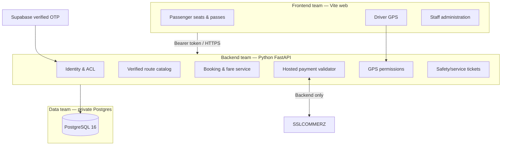

# Architecture and team boundaries

## Contract ownership

- `frontend/src/features/*`: UI only. Feature owners may modify their own feature directories. `frontend/src/core/context.js` is a shared contract; changes require frontend review.
- `backend/app/modules/*`: FastAPI routers and domain services. Each route is documented in generated OpenAPI (development mode). Authentication, payments, and booking changes require security/backend review.
- `backend/app/core/*`: shared security, SQL connection, rate limiting. Small and explicitly shared. No feature-specific SQL queries here.
- `database/migrations/`: append-only, numbered, reviewed migration files. The application never calls `CREATE TABLE` during ordinary HTTP requests.
- `infra/`: infrastructure/operations-owned. No credentials committed.

## Invariants enforced

1. Physical passenger seats are stored only in `app.vehicle_seats`, not guessed by passenger UI.
2. `btree_gist` PostgreSQL exclusion protects each seat from date-overlapping holds/confirmed reservations, even for separate services using that seat.
3. Each physical vehicle may belong to only one active recurring service. This deliberately conservative rule can be revisited after scheduling and conflict proofs exist.
4. Every hold is server-quoted in integer BDT and locked with `FOR UPDATE` on the service/user. Client price is display-only.
5. A user cannot have parallel valid welcome-discount subscriptions. Discounts are non-stacking.
6. Vehicle certificates must cover the prepaid reservation period.
7. Payment callback is advisory only until SSLCOMMERZ validates the transaction server-to-server.
8. Roles are database-owned; `user_metadata` and browser JWT custom role fields never authorize staff actions.
9. Driver GPS requires verified driver role, active service assignment and compliance; passenger GPS read requires active paid seat and a permitted commuting window.
10. Operations approvals, staff role changes and support workflow changes generate audit records.

## Public, private, and admin APIs

Frontend calls same FastAPI service over HTTPS. No SQL port is exposed to browsers. The Supabase publishable key is public; service-role secrets and payment merchant passwords are **server-side only**. Platform/operations teams must provide WAF, TLS termination, IPN ingress and private network boundaries.
