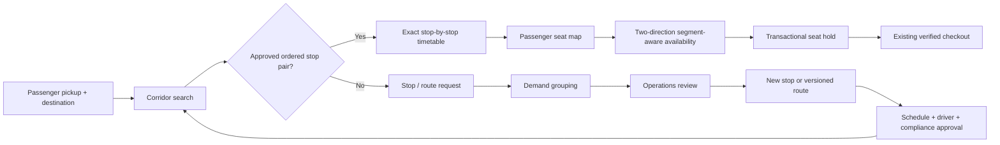

# TRIPPY Next — Corridor-first Operations & Premium Web Experience

**Status:** Development / review branch. Production deployment requires a separately approved release.
**Purpose:** TRIPPY itself plans and operates scheduled morning and evening corporate rides along **approved fixed corridors with multiple boarding and drop-off stops**. Customers may take any valid, ordered section of a published route. Customer demand informs future stop/route/capacity expansion; it never activates a vehicle automatically.

## Product principles

- Real services use real verified vehicles, approved boarding stops, licensed drivers, compliant documents and published schedules.
- A vehicle may serve many customer origin/destination pairs along the same approved corridor.
- A customer can reserve a specific physical passenger seat for a subscribed interval and both morning/evening journeys. The same seat may serve **different people on different non-overlapping legs** of the *same* route and date range.
- Users looking outside the network can request **new route**, **additional stop**, or **more seats**, with preferred morning and return times. TRIPPY Operations reviews aggregate demand and makes the service decision.
- TRIPPY is **not** described as already having an AI recommender, automatically allocated fleet, guaranteed CO₂ savings, or live vehicles when these functions are not verified.
- The separate **Demo Bus** simulation continues to use its own booking tables and simulated payment choices. No demonstration purchase can create a real paid seat.

## Architecture

### Segment example

Single 28-seat bus, approved corridor **Abdullahpur → Uttara → Banani → Mohakhali → Farmgate → Motijheel**.

- Customer A reserves seat **B6**, morning **Abdullahpur → Banani**, evening **Banani → Abdullahpur**.
- Customer B reserves the same B6, morning **Banani → Motijheel**, evening **Motijheel → Banani**.
- Both journeys have different half-open leg intervals; they can coexist during overlapping subscription dates.
- Customer C trying to reserve B6 from **Uttara → Farmgate** at the same dates conflicts with both morning and evening journey legs and must be rejected by PostgreSQL itself.
- A passenger's displayed **boarding / arrival time** comes from their assigned intermediate stop, *not* from the bus terminal departure.

## Database and concurrency

- Migration `007_segment_seat_inventory.sql` adds `app.reservations.morning_segment` and `evening_segment` as `int4range`. Existing reservations are backfilled from existing approved stop ordering. Migration aborts if a historic record cannot be migrated unambiguously.
- Two independent GiST exclusion constraints enforce physical seat/date/segment exclusivity on **morning** and **evening** journeys. Both are created before the old all-day seat constraint is removed.
- Held, confirmed and payment-review reservations are protected; release/expiry logic and server-authoritative pricing remain unchanged.
- Migration `008_corridor_demand_timetable.sql` creates `app.service_stop_times` and adds structured demand metadata (type, preferred times, internal review status/notes).
- Physical cabin capacity and licensed seat maps remain untouched and vehicle-specific.
- No extra passenger seats, routes, refunds, payments or driver credentials are ever automatically generated from demand.

## API contracts added / updated

| Method / route | Purpose |
| --- | --- |
| `GET /api/services?pickup=&office=&vehicleClass=` | Finds active verified services serving any correctly ordered intermediate morning/return stop pair. Returns matched stop IDs and planned boarding/arrival times. |
| `GET /api/services/{id}` | Approved ordered stops and per-stop planned arrival times. |
| `GET /api/services/{id}/seats?startDate=&months=&pickupStopId=&dropoffStopId=` | Exact seat occupancy for both requested journey legs. Omitting stops returns a conservative whole-corridor occupancy for older clients. |
| `POST /api/reservations/hold` | Atomic per-segment hold on morning and return journey; enforces approved stops and PostgreSQL exclusions. |
| `POST /api/demand` | Submit new-route, new-stop or additional-capacity request with optional commute times and notes. |
| `GET /api/admin/demand/summary` | Group existing requests by case-insensitive pickup/destination and request type. |
| `PATCH /api/admin/demand/{id}` | Audited review status and internal note; admin/dispatcher with MFA. |
| `GET /api/admin/routes/{id}/stops` | Read approved route stop order to create a versioned revision. |
| `GET /api/admin/services/{id}/timetable` | Current per-stop morning and reverse evening times. |
| `PUT /api/admin/services/{id}/timetable` | Save complete, monotonically ordered arrival timetable on inactive, never-booked service. |

## Safe route and schedule changes

**Never edit an active, booked route in place.** Changes to stop order and schedule can strand paid passengers or invalidate booked segments.

1. Operations reviews grouped demand.
2. An authorized administrator adds a real physical boarding stop, including its coordinates and verification status.
3. **Plan a revised corridor** loads an existing route and allows staff to insert/reorder approved stops. Saving creates a **separate new route** with the reverse evening sequence; the old route is unchanged.
4. Staff register or assign a verified vehicle to a new inactive service for the updated route.
5. Under **Timetables**, enter times for every stop in the morning and evening. First times must match service departure, and subsequent stops must strictly increase in travel order.
6. A service can activate only after driver assignment, vehicle compliance, correct seat count, approved route and **complete stop timetable**.
7. Operations retires the previous service only through reviewed changeover steps, keeping historical paid bookings and audit records.

## Customer experience

The new visual language is premium dark green/teal with luminous accents, high-contrast cards, a transparent **illustrative corridor** (not falsely marketed as live), full-size Dhaka location autocomplete, progress steps, responsive mobile navigation, matched-route cards and stop-aware seating.

From **Pickup area + Destination**, TRIPPY finds journeys across *all approved stops* in published corridors. A customer sees the actual boarding/drop-off stop, morning and evening times, selects both approved stops, then chooses a numbered seat. Availability is recalculated whenever the selected stops change. The existing server-owned fare/checkout flow is preserved.

If no route exists, the customer can request a new stop, corridor, or more capacity; TRIPPY makes no automatic guarantee.

## Environments and release gates

**DEV only until QA approval.** The development Supabase project `jhfoxjqerwqpryjpoixy` received migrations 007 and 008. No production database migration or booking logic deployment was applied by this work.

- **Cloudflare branch preview**: `https://feature-corridor-operations.trippy-corporate-mobility.pages.dev/` (the UI preview may still be configured against an older/live API; do not use it for real paid bookings).
- **Production**: `https://trippy-corporate-mobility.pages.dev/` must remain on the previously approved stable release until the separate DEV FastAPI service runs this branch.
- Before any PRD merge, connect the Cloudflare preview to a **dedicated development Cloud Run FastAPI** instance and the **development** Supabase database. Do not reuse a production database URL, production OAuth secrets, production SSLCOMMERZ merchant or commercial live notifications.
- Run the CI PostgreSQL concurrency integration on a disposable **test** DB; retest route discovery, segment holds, morning/evening disjoint trips, expired holds, 1/3/6/12-month windows, tab/mobile selection and no-route demand forms with verified DEV accounts.
- Physically validate boarding stop coordinates, route legality, authorized vehicles, drivers and timetable; verify backend security and payment gateway before production.
- If production ever has paid bookings, review/back up all legacy records before migration 007. The migration intentionally rejects ambiguous historical stop orders.
- Supabase's advisor may flag RLS disabled on private `app` schema tables. Direct privilege checks currently show the `anon` and `authenticated` roles cannot use/read that schema. Still review RLS as defense-in-depth and Data API schema exposure before external launch; do not blindly enable RLS without matching policies.

## Known constraints and follow-ups

- Price rules remain full monthly per seat (no distance-prorating approved).
- Route search uses approved names/zones, not road-network driving-distance optimization or guaranteed nearest-stop calculations.
- Grouped demand is exact normalized textual corridor grouping; it does not yet use ML clustering, geofencing, or automated dispatch. This is intentional and truthful.
- An active service is conservative: one recurring physical vehicle per service, and a booked route cannot be revised in place.
- Browser/device level QA and a fully connected DEV deployment remain explicit release requirements, even when GitHub CI passes.
