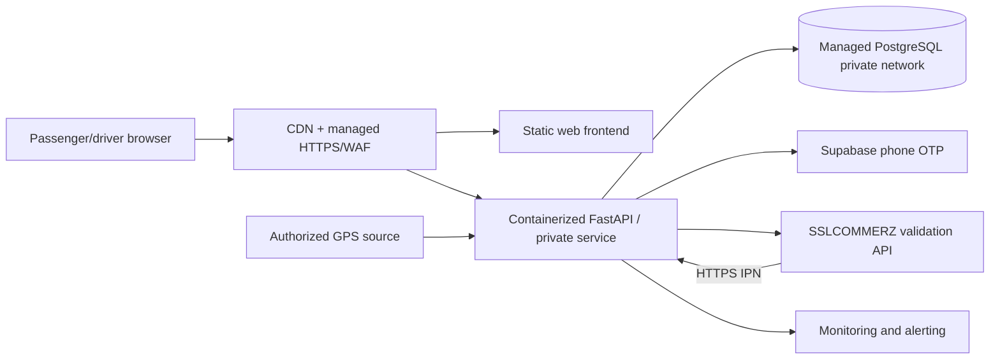

# Infrastructure boundary — production environment design

`compose.yaml` is **local development only**. Production infrastructure has **not** been provisioned by this repository.

## Recommended initial deployment topology

Use independent deployment pipelines, domains/subdomains, scoped credentials, least privilege, separate environments (dev/staging/prod), immutable image tags, pre-deploy database migrations, backups with tested restores, centralized logs and exception capture. Restrict network access to DB and merchant secrets. Plan secure webhook ingress and retry-safe reconciliation.

For a small pilot, choose a managed container service for FastAPI, a static hosting service for Vite output, and managed Postgres. **No provider capacity, pricing, uptime guarantee, security certification, or actual deployment is implied.**

## Secret inventory (never commit values)

`DATABASE_URL`, `SUPABASE_URL`, `SUPABASE_PUBLISHABLE_KEY`, `SSLCOMMERZ_STORE_ID`, `SSLCOMMERZ_STORE_PASSWORD`, `APP_ENV`, `WEB_ORIGIN`, `PUBLIC_BASE_URL`, plus frontend-only `VITE_` publishable values.

Server secrets must be stored in the platform's secret manager. Use private PostgreSQL, HTTPS, no public debug endpoints, staff MFA and environment-scoped access controls. Rollout should be blocked unless the production-readiness checklist has approvals.
